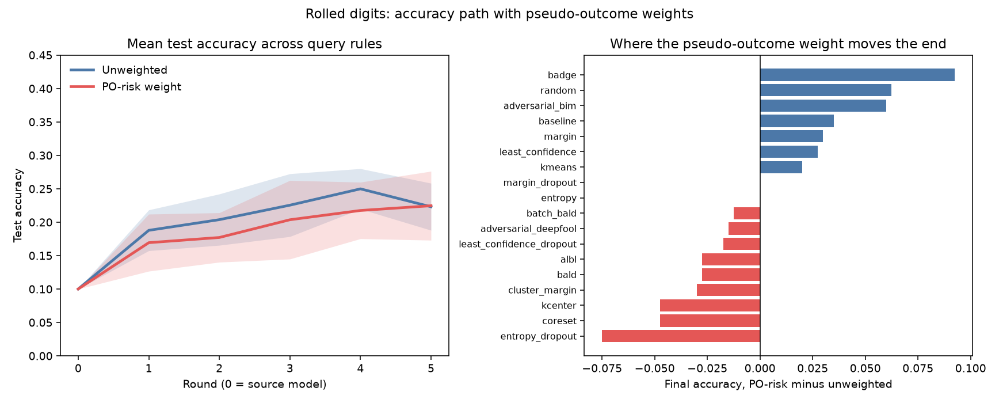

# 手写数字上的准确率路径

数据换成 sklearn 的 8×8 手写数字。源分布是原图像。目标分布把每张图沿水平方向滚两个像素，标签不变。参考窗前一半是源，后一半是目标。池子里一半原图、一半滚过的图。测试集全是滚过的图。

查询规则接的是 deep active learning 里能在同一个分类网络上算的那些：不确定性、dropout 版、BALD、BatchBALD、core-set、k-center、k-means、cluster-margin、BADGE、baseline、BIM、DeepFool、ALBL。每条规则跑两遍，一遍权重是平的，一遍权重是参考窗上拟合的伪结果残差。VAAL、WAAL、learning-loss、GCN 和半监督那一组要换训练器，没有接进这个网络。

种子 0, 1。左图是全部规则的平均路径，色带是规则之间的标准差。右图是每条规则终点准确率的差，伪结果权重减去无权重。

路径下的面积：无权重 0.206，伪结果权重 0.186。抽到的目标行比例：无权重 0.603，伪结果权重 0.457。池子里这个比例是 0.50。

终点准确率几乎一样：无权重 0.223，伪结果权重 0.225。
终点最高的是 `least_confidence_po`，准确率 0.325，比起点高 +0.225。

| 方案 | 查询 | 权重 | 起点 | 终点 | lift | 面积 | 目标行 |
| --- | --- | --- | ---: | ---: | ---: | ---: | ---: |
| least_confidence_po | least_confidence | po_risk | 0.100 | 0.325 | +0.225 | 0.213 | 0.372 |
| adversarial_bim_po | adversarial_bim | po_risk | 0.100 | 0.310 | +0.210 | 0.225 | 0.972 |
| least_confidence | least_confidence | uniform | 0.100 | 0.297 | +0.198 | 0.223 | 0.631 |
| random_po | random | po_risk | 0.100 | 0.295 | +0.195 | 0.197 | 0.287 |
| albl | albl | uniform | 0.100 | 0.270 | +0.170 | 0.199 | 0.769 |
| badge_po | badge | po_risk | 0.100 | 0.265 | +0.165 | 0.207 | 0.347 |
| entropy_dropout | entropy_dropout | uniform | 0.100 | 0.260 | +0.160 | 0.229 | 0.850 |
| entropy | entropy | uniform | 0.100 | 0.258 | +0.158 | 0.214 | 0.622 |
| entropy_po | entropy | po_risk | 0.100 | 0.258 | +0.158 | 0.194 | 0.344 |
| adversarial_bim | adversarial_bim | uniform | 0.100 | 0.250 | +0.150 | 0.221 | 0.663 |
| margin_po | margin | po_risk | 0.100 | 0.247 | +0.147 | 0.221 | 0.894 |
| margin_dropout | margin_dropout | uniform | 0.100 | 0.242 | +0.142 | 0.206 | 0.728 |
| margin_dropout_po | margin_dropout | po_risk | 0.100 | 0.242 | +0.143 | 0.218 | 0.891 |
| albl_po | albl | po_risk | 0.100 | 0.242 | +0.142 | 0.188 | 0.584 |
| batch_bald | batch_bald | uniform | 0.100 | 0.240 | +0.140 | 0.205 | 0.541 |
| random | random | uniform | 0.100 | 0.232 | +0.133 | 0.196 | 0.503 |
| batch_bald_po | batch_bald | po_risk | 0.100 | 0.228 | +0.128 | 0.151 | 0.247 |
| adversarial_deepfool | adversarial_deepfool | uniform | 0.100 | 0.228 | +0.128 | 0.202 | 0.528 |
| baseline_po | baseline | po_risk | 0.100 | 0.220 | +0.120 | 0.176 | 0.441 |
| margin | margin | uniform | 0.100 | 0.217 | +0.117 | 0.209 | 0.700 |
| adversarial_deepfool_po | adversarial_deepfool | po_risk | 0.100 | 0.213 | +0.113 | 0.242 | 0.691 |
| least_confidence_dropout | least_confidence_dropout | uniform | 0.100 | 0.208 | +0.107 | 0.232 | 0.831 |
| bald | bald | uniform | 0.100 | 0.200 | +0.100 | 0.199 | 0.538 |
| coreset | coreset | uniform | 0.100 | 0.200 | +0.100 | 0.170 | 0.419 |
| kcenter | kcenter | uniform | 0.100 | 0.200 | +0.100 | 0.170 | 0.419 |
| cluster_margin | cluster_margin | uniform | 0.100 | 0.193 | +0.092 | 0.224 | 0.600 |
| least_confidence_dropout_po | least_confidence_dropout | po_risk | 0.100 | 0.190 | +0.090 | 0.141 | 0.231 |
| entropy_dropout_po | entropy_dropout | po_risk | 0.100 | 0.185 | +0.085 | 0.103 | 0.156 |
| baseline | baseline | uniform | 0.100 | 0.185 | +0.085 | 0.210 | 0.541 |
| kmeans_po | kmeans | po_risk | 0.100 | 0.182 | +0.082 | 0.173 | 0.475 |
| bald_po | bald | po_risk | 0.100 | 0.172 | +0.072 | 0.183 | 0.216 |
| badge | badge | uniform | 0.100 | 0.172 | +0.072 | 0.223 | 0.481 |
| kmeans | kmeans | uniform | 0.100 | 0.163 | +0.062 | 0.170 | 0.484 |
| cluster_margin_po | cluster_margin | po_risk | 0.100 | 0.163 | +0.062 | 0.183 | 0.619 |
| coreset_po | coreset | po_risk | 0.100 | 0.153 | +0.053 | 0.166 | 0.231 |
| kcenter_po | kcenter | po_risk | 0.100 | 0.153 | +0.053 | 0.166 | 0.231 |

重复次数 2。
