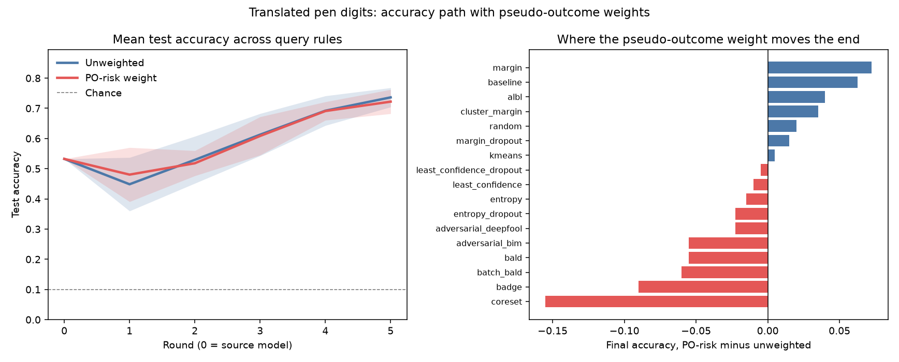

# 手写笔数字上的准确率路径

数据是 UCI 的手写笔数字。十六个坐标先除以 100，落在 0 到 1。目标行的八个横坐标各加 0.25，等于把笔迹沿 x 平移，数字标签不变。参考窗前一半是原笔迹，后一半是平移后的笔迹。池子里一半对一半。测试集全是平移后的笔迹。

查询规则接的是 deep active learning 里能在同一个分类网络上算的那些：不确定性、dropout 版、BALD、BatchBALD、core-set、k-center、k-means、cluster-margin、BADGE、baseline、BIM、DeepFool、ALBL。每条规则跑两遍，一遍权重是平的，一遍权重是参考窗上拟合的伪结果残差。VAAL、WAAL、learning-loss、GCN 和半监督那一组要换训练器，没有接进这个网络。

种子 0, 1。左图是各规则的平均路径，色带是规则之间的标准差，虚线是 10 类的随机猜测。k-center 和 core-set 是同一条最远点规则，平均和右图只计 core-set 一次。右图是终点准确率的差，伪结果权重减去无权重。

路径下的面积：无权重 0.583，伪结果权重 0.585。抽到的目标行比例：无权重 0.502，伪结果权重 0.392。池子里这个比例是 0.50。

伪结果权重没有抬高终点准确率。无权重平均 0.736，加权平均 0.722。
终点最高的是 `coreset`，准确率 0.815，比起点高 +0.283。

| 方案 | 查询 | 权重 | 起点 | 终点 | lift | 面积 | 目标行 |
| --- | --- | --- | ---: | ---: | ---: | ---: | ---: |
| coreset | coreset | uniform | 0.532 | 0.815 | +0.283 | 0.640 | 0.537 |
| kcenter | kcenter | uniform | 0.532 | 0.815 | +0.283 | 0.640 | 0.537 |
| baseline_po | baseline | po_risk | 0.532 | 0.812 | +0.280 | 0.647 | 0.372 |
| badge | badge | uniform | 0.532 | 0.778 | +0.245 | 0.592 | 0.509 |
| entropy_dropout | entropy_dropout | uniform | 0.532 | 0.768 | +0.235 | 0.525 | 0.497 |
| adversarial_deepfool | adversarial_deepfool | uniform | 0.532 | 0.765 | +0.233 | 0.575 | 0.500 |
| albl_po | albl | po_risk | 0.532 | 0.758 | +0.225 | 0.621 | 0.438 |
| margin_po | margin | po_risk | 0.532 | 0.755 | +0.223 | 0.566 | 0.787 |
| kmeans_po | kmeans | po_risk | 0.532 | 0.752 | +0.220 | 0.651 | 0.312 |
| cluster_margin_po | cluster_margin | po_risk | 0.532 | 0.750 | +0.218 | 0.588 | 0.653 |
| baseline | baseline | uniform | 0.532 | 0.750 | +0.218 | 0.648 | 0.491 |
| bald | bald | uniform | 0.532 | 0.748 | +0.215 | 0.541 | 0.569 |
| kmeans | kmeans | uniform | 0.532 | 0.748 | +0.215 | 0.683 | 0.466 |
| entropy_dropout_po | entropy_dropout | po_risk | 0.532 | 0.745 | +0.213 | 0.592 | 0.084 |
| margin_dropout_po | margin_dropout | po_risk | 0.532 | 0.745 | +0.213 | 0.555 | 0.781 |
| random_po | random | po_risk | 0.532 | 0.742 | +0.210 | 0.595 | 0.387 |
| adversarial_deepfool_po | adversarial_deepfool | po_risk | 0.532 | 0.742 | +0.210 | 0.539 | 0.588 |
| batch_bald | batch_bald | uniform | 0.532 | 0.740 | +0.208 | 0.611 | 0.613 |
| margin_dropout | margin_dropout | uniform | 0.532 | 0.730 | +0.198 | 0.618 | 0.500 |
| random | random | uniform | 0.532 | 0.723 | +0.190 | 0.616 | 0.475 |
| adversarial_bim | adversarial_bim | uniform | 0.532 | 0.722 | +0.190 | 0.582 | 0.503 |
| albl | albl | uniform | 0.532 | 0.718 | +0.185 | 0.558 | 0.475 |
| cluster_margin | cluster_margin | uniform | 0.532 | 0.715 | +0.183 | 0.602 | 0.500 |
| least_confidence_dropout | least_confidence_dropout | uniform | 0.532 | 0.713 | +0.180 | 0.528 | 0.481 |
| least_confidence | least_confidence | uniform | 0.532 | 0.710 | +0.178 | 0.492 | 0.488 |
| least_confidence_dropout_po | least_confidence_dropout | po_risk | 0.532 | 0.708 | +0.175 | 0.591 | 0.131 |
| least_confidence_po | least_confidence | po_risk | 0.532 | 0.700 | +0.168 | 0.577 | 0.153 |
| entropy | entropy | uniform | 0.532 | 0.695 | +0.163 | 0.517 | 0.472 |
| bald_po | bald | po_risk | 0.532 | 0.693 | +0.160 | 0.555 | 0.156 |
| badge_po | badge | po_risk | 0.532 | 0.688 | +0.155 | 0.609 | 0.366 |
| margin | margin | uniform | 0.532 | 0.682 | +0.150 | 0.590 | 0.463 |
| entropy_po | entropy | po_risk | 0.532 | 0.680 | +0.148 | 0.568 | 0.172 |
| batch_bald_po | batch_bald | po_risk | 0.532 | 0.680 | +0.148 | 0.562 | 0.144 |
| adversarial_bim_po | adversarial_bim | po_risk | 0.532 | 0.667 | +0.135 | 0.514 | 0.919 |
| coreset_po | coreset | po_risk | 0.532 | 0.660 | +0.128 | 0.615 | 0.228 |
| kcenter_po | kcenter | po_risk | 0.532 | 0.660 | +0.128 | 0.615 | 0.228 |

k-center 与 core-set 的数字相同，因为两者都是嵌入上的最远点。上面的平均没有把它算第二次。

重复次数 2。
