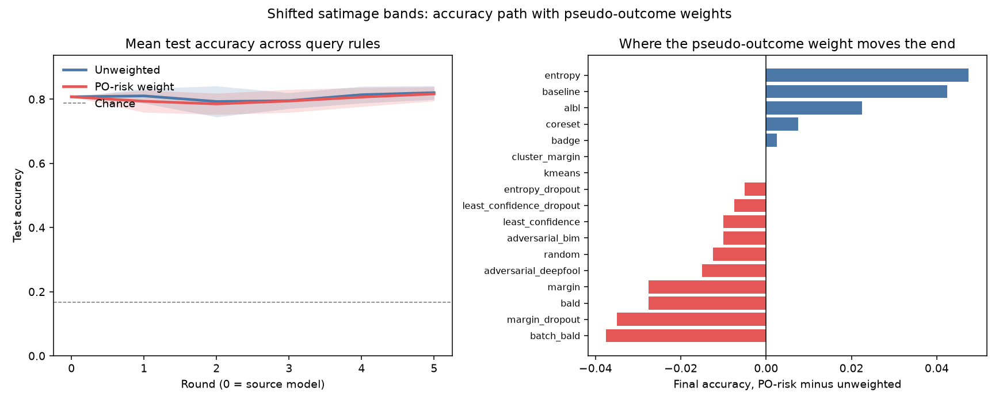

# 卫星图像上的准确率路径

数据是 Statlog 的 Landsat 卫星图像，OpenML 上的表已经按特征标准化过。目标行的前 9 个波段各加 1.25，地物类别不变。这是传感器偏移，不是改标签。参考窗前一半是原光谱，后一半是偏移后的光谱。池子里一半对一半。测试集全是偏移后的光谱。

查询规则接的是 deep active learning 里能在同一个分类网络上算的那些：不确定性、dropout 版、BALD、BatchBALD、core-set、k-center、k-means、cluster-margin、BADGE、baseline、BIM、DeepFool、ALBL。每条规则跑两遍，一遍权重是平的，一遍权重是参考窗上拟合的伪结果残差。VAAL、WAAL、learning-loss、GCN 和半监督那一组要换训练器，没有接进这个网络。

种子 0, 1。左图是各规则的平均路径，色带是规则之间的标准差，虚线是 6 类的随机猜测。k-center 和 core-set 是同一条最远点规则，平均和右图只计 core-set 一次。右图是终点准确率的差，伪结果权重减去无权重。

路径下的面积：无权重 0.805，伪结果权重 0.798。抽到的目标行比例：无权重 0.527，伪结果权重 0.449。池子里这个比例是 0.50。

终点准确率几乎一样：无权重 0.820，伪结果权重 0.816。
终点最高的是 `adversarial_deepfool`，准确率 0.857，比起点高 +0.050。

| 方案 | 查询 | 权重 | 起点 | 终点 | lift | 面积 | 目标行 |
| --- | --- | --- | ---: | ---: | ---: | ---: | ---: |
| adversarial_deepfool | adversarial_deepfool | uniform | 0.807 | 0.857 | +0.050 | 0.821 | 0.509 |
| baseline_po | baseline | po_risk | 0.807 | 0.853 | +0.045 | 0.807 | 0.500 |
| least_confidence | least_confidence | uniform | 0.807 | 0.843 | +0.035 | 0.784 | 0.544 |
| badge_po | badge | po_risk | 0.807 | 0.843 | +0.035 | 0.814 | 0.422 |
| adversarial_deepfool_po | adversarial_deepfool | po_risk | 0.807 | 0.843 | +0.035 | 0.802 | 0.637 |
| badge | badge | uniform | 0.807 | 0.840 | +0.033 | 0.823 | 0.550 |
| coreset_po | coreset | po_risk | 0.807 | 0.840 | +0.032 | 0.769 | 0.222 |
| kcenter_po | kcenter | po_risk | 0.807 | 0.840 | +0.032 | 0.769 | 0.222 |
| margin | margin | uniform | 0.807 | 0.837 | +0.030 | 0.798 | 0.547 |
| least_confidence_po | least_confidence | po_risk | 0.807 | 0.833 | +0.025 | 0.813 | 0.366 |
| coreset | coreset | uniform | 0.807 | 0.833 | +0.025 | 0.806 | 0.512 |
| kcenter | kcenter | uniform | 0.807 | 0.833 | +0.025 | 0.806 | 0.512 |
| adversarial_bim | adversarial_bim | uniform | 0.807 | 0.830 | +0.023 | 0.795 | 0.512 |
| least_confidence_dropout | least_confidence_dropout | uniform | 0.807 | 0.830 | +0.022 | 0.821 | 0.509 |
| entropy_dropout | entropy_dropout | uniform | 0.807 | 0.827 | +0.020 | 0.808 | 0.534 |
| random | random | uniform | 0.807 | 0.825 | +0.018 | 0.828 | 0.491 |
| entropy_dropout_po | entropy_dropout | po_risk | 0.807 | 0.823 | +0.015 | 0.775 | 0.172 |
| least_confidence_dropout_po | least_confidence_dropout | po_risk | 0.807 | 0.823 | +0.015 | 0.806 | 0.194 |
| bald | bald | uniform | 0.807 | 0.823 | +0.015 | 0.799 | 0.528 |
| adversarial_bim_po | adversarial_bim | po_risk | 0.807 | 0.820 | +0.012 | 0.786 | 0.916 |
| cluster_margin_po | cluster_margin | po_risk | 0.807 | 0.818 | +0.010 | 0.799 | 0.681 |
| cluster_margin | cluster_margin | uniform | 0.807 | 0.817 | +0.010 | 0.833 | 0.531 |
| entropy_po | entropy | po_risk | 0.807 | 0.815 | +0.008 | 0.794 | 0.291 |
| albl_po | albl | po_risk | 0.807 | 0.815 | +0.008 | 0.792 | 0.475 |
| random_po | random | po_risk | 0.807 | 0.812 | +0.005 | 0.832 | 0.341 |
| batch_bald | batch_bald | uniform | 0.807 | 0.812 | +0.005 | 0.797 | 0.566 |
| margin_po | margin | po_risk | 0.807 | 0.810 | +0.003 | 0.796 | 0.831 |
| baseline | baseline | uniform | 0.807 | 0.810 | +0.003 | 0.810 | 0.544 |
| margin_dropout | margin_dropout | uniform | 0.807 | 0.807 | +0.000 | 0.822 | 0.522 |
| bald_po | bald | po_risk | 0.807 | 0.795 | -0.013 | 0.809 | 0.200 |
| kmeans | kmeans | uniform | 0.807 | 0.792 | -0.015 | 0.792 | 0.525 |
| kmeans_po | kmeans | po_risk | 0.807 | 0.792 | -0.015 | 0.806 | 0.350 |
| albl | albl | uniform | 0.807 | 0.792 | -0.015 | 0.792 | 0.544 |
| batch_bald_po | batch_bald | po_risk | 0.807 | 0.775 | -0.032 | 0.789 | 0.212 |
| margin_dropout_po | margin_dropout | po_risk | 0.807 | 0.772 | -0.035 | 0.781 | 0.831 |
| entropy | entropy | uniform | 0.807 | 0.768 | -0.040 | 0.760 | 0.494 |

k-center 与 core-set 的数字相同，因为两者都是嵌入上的最远点。上面的平均没有把它算第二次。

重复次数 2。
